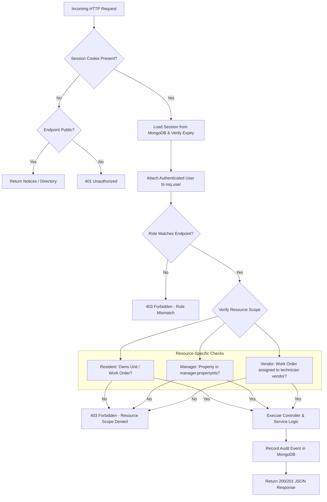

# Access Control & Authorization Model

## 1. Role-Based Access Control (RBAC) Matrix

| Resource / Endpoint | Resident | Property Manager | Vendor Technician | Unauthenticated |
| :--- | :--- | :--- | :--- | :--- |
| **Public Community Info / Notices** | Read | Read / Write | Read | Read |
| **Create Work Order** | Authorized Unit / Shared | Yes | No | No |
| **View Work Order** | Own Tickets Only | Authorized Properties | Assigned Tickets Only | Denied |
| **Assign Vendor** | Denied | Scoped Properties | Denied | Denied |
| **Submit Estimate** | Denied | Denied | Assigned Tickets Only | Denied |
| **Approve / Reject Estimate** | If Released (<$500 rules) | Scoped Properties | Denied | Denied |
| **Update Work Progress** | Denied | Denied | Assigned Tickets Only | Denied |
| **Upload Completion Evidence** | Denied | Denied | Assigned Tickets Only | Denied |
| **Completion Review / Reopen** | Own Tickets Only | Review & Next Steps | Denied | Denied |
| **AI Maintenance Chat (RAG)** | Grounded Resident Scope | Property Scope | Assigned Trade Docs | Denied |
| **AI Related-Case Discovery** | Denied | Scoped Property Only | Denied | Denied |
| **AI Scheduling Agent Run** | Denied | Scoped Property Only | Denied | Denied |
| **Schedule Confirmation** | Denied | Scoped Property Only | Denied | Denied |
| **Upload / Delete Policies** | Denied | Scoped Property Only | Denied | Denied |
| **Audit Logs** | Denied | Scoped Property Only | Denied | Denied |

## 2. Authorization Flow Diagram

## 3. Data Isolation Guarantees

1. **Resident Privacy Guarantee**: Residents can only query work orders, attachments, and chat conversations where `residentId == session.userId` or for permitted shared areas. Residents cannot access unit numbers, attachments, or names of other tenants.
2. **Property Manager Scoping**: Property Managers have operations restricted to `propertyId` values explicitly assigned to their account (`user.propertyIds`). Managers cannot query or approve work orders, estimates, or documents for outside properties.
3. **Vendor Assignment Scoping**: Vendor technicians cannot access work orders unless an active record exists in `assignments` linking `vendorId` or `technicianId` to the specific `workOrderId`. Expired assignments immediately revoke file download and update access.
4. **Pre-Retrieval Vector Filtering**: Vector queries for related-case discovery and RAG retrieval enforce `{ propertyId: req.user.propertyIds }` filters before similarity rankings reach the language model, preventing cross-tenant document exposure.
