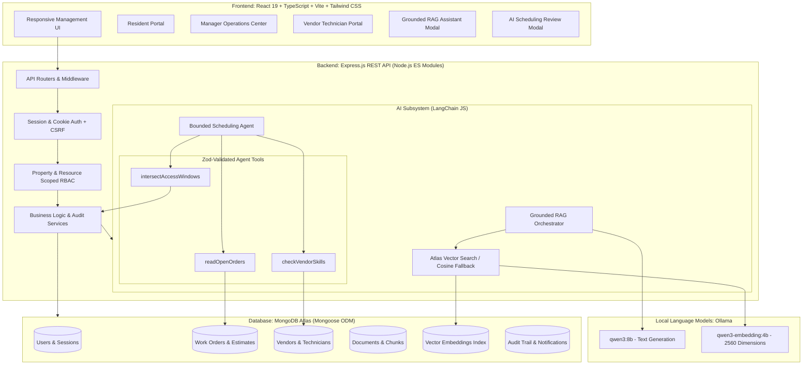

# System Architecture: Apartment Maintenance Operations

## 1. High-Level Architectural Diagram

## 2. Component Structure

- **Client Tier**:
  - React 19 with Vite, TypeScript, Tailwind CSS v4, Lucide React icons.
  - Role-based views: Resident (Unit-scoped), Property Manager (Property-scoped), Vendor Technician (Assignment-scoped).
  - API Client handles HttpOnly cookie session credentials, automated CSRF header forwarding, and standard error serialization.
  - Interactive modals for grounded RAG maintenance chat with verified citations, and human-in-the-loop AI scheduling proposal review.

- **API & Middleware Tier**:
  - Express.js backend written in modern ES modules following the code style of `mern-ai-integration-patterns`.
  - Session-based authentication stored in MongoDB (`SessionModel`) with HttpOnly cookies.
  - Centralized authorization middleware verifying property and unit ownership before data retrieval.
  - Multer middleware generating cryptographically secure UUID filenames for text-based PDF/TXT uploads.

- **AI Orchestration Tier**:
  - **Document RAG**: Document text extraction via `unpdf`, chunk splitting, Ollama embeddings generation (`qwen3-embedding:4b`), and similarity search with citations. Built-in emergency detector and hazardous DIY prevention guardrails.
  - **Semantic Related-Case Discovery**: Scoped strictly to the same property to identify related issues (e.g. upstairs leaks affecting downstairs ceilings) without leaking other property records.
  - **Bounded Scheduling Agent**: 3 deterministic tools (`readOpenOrders`, `checkVendorSkills`, `intersectAccessWindows`) with Zod argument validation. AI produces proposals; manager explicitly approves via atomic confirmation endpoint.
