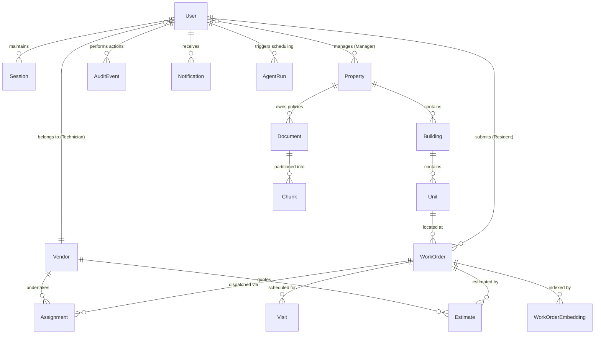

# Database Schema & Data Relationships

The application persists all records in **MongoDB Atlas** using **Mongoose ODM**. Following the patterns established in `mern-ai-integration-patterns`, schemas enforce strict document validation (`strict: "throw"`), disable internal version keys (`versionKey: false`), and enable automated timestamps (`timestamps: true`).

## 1. Schema Entity Relationship Diagram

## 2. Key Collections & Field Schemas

### Users (`users`)
- `email`: String (Unique, Indexed, Lowercase)
- `passwordHash`: String (Argon2id/Bcrypt hash)
- `role`: Enum (`resident`, `property_manager`, `vendor_technician`)
- `fullName`: String
- `phoneNumber`: String (Optional)
- `emailVerified`: Boolean (Default: true for demo seeds)
- `accountStatus`: Enum (`Active`, `Suspended`, `Pending`)
- `propertyIds`: Array of ObjectId refs to `Property`
- `unitId`: ObjectId ref to `Unit`
- `vendorId`: ObjectId ref to `Vendor`

### Sessions (`sessions`)
- `sessionToken`: String (Indexed)
- `userId`: ObjectId ref to `User`
- `csrfToken`: String (For anti-CSRF protection)
- `expiresAt`: Date (TTL Index)
- `lastActivity`: Date

### Properties (`properties`)
- `name`: String
- `address`: Embedded subdocument (street, city, state, zip)
- `timezone`: String (e.g. `America/New_York`)
- `spendingApprovalLimit`: Number (Default: $500 threshold)
- `officeHours`: String
- `emergencyContacts`: Array of `{ name, phone, serviceType }`
- `status`: Enum (`Active`, `Archived`)

### Units (`units`)
- `propertyId`: ObjectId ref to `Property` (Indexed)
- `buildingId`: ObjectId ref to `Building`
- `unitNumber`: String
- `floor`: Number
- `status`: Enum (`Occupied`, `Vacant`, `Maintenance Hold`)

### WorkOrders (`work_orders`)
- `orderNumber`: String (Unique, format `WO-YYYY-XXXX`)
- `propertyId`: ObjectId ref to `Property` (Indexed)
- `unitId`: ObjectId ref to `Unit` (Optional for shared areas)
- `sharedAreaDescription`: String (Optional)
- `residentId`: ObjectId ref to `User` (Indexed)
- `category`: Enum (`plumbing`, `electrical`, `hvac`, `appliances`, `fixtures`, `structural`, `cleaning`)
- `title`: String
- `description`: String
- `priority`: Enum (`Low`, `Normal`, `High`, `Emergency`)
- `status`: Enum (`Submitted`, `Under Review`, `Awaiting Estimate`, `Awaiting Approval`, `Approved`, `Scheduled`, `Assigned`, `In Progress`, `Work Completed — Awaiting Review`, `Resolved`, `Reopened`, `Cancelled`, `Rejected`)
- `preferredAccessWindows`: Array of `{ date, timeSlot }`
- `accessNotes`: String (Private to authorized assignees)
- `attachments`: Array of `{ filename, originalName, mimeType, size, uploadedAt }`
- `currentAssignment`: ObjectId ref to `Assignment`
- `activeEstimate`: ObjectId ref to `Estimate`
- `completionNotes`: String
- `completionEvidence`: Array of `{ filename, originalName, mimeType, size, uploadedAt }`
- `reopenReason`: String

### Estimates (`estimates`)
- `workOrderId`: ObjectId ref to `WorkOrder` (Indexed)
- `vendorId`: ObjectId ref to `Vendor`
- `revision`: Number (Default: 1, incremental)
- `lineItems`: Array of `{ description, category, quantity, unitPrice, total }`
- `subtotal`: Number (Calculated by server)
- `tax`: Number (Calculated by server)
- `total`: Number (Calculated by server)
- `currency`: String (Default: 'USD')
- `status`: Enum (`Draft`, `Submitted`, `Approved`, `Rejected`, `Revision Requested`)
- `decisionNotes`: String
- `decidedBy`: ObjectId ref to `User`
- `decidedAt`: Date

### Documents & Chunks (`documents` & `chunks`)
- `Document`: Title, documentType, propertyId, storagePath, processingStatus (`Pending`, `Extracting`, `Embedding`, `Ready`, `Failed`), chunkCount, embeddingModel.
- `Chunk`: documentId, chunkIndex, text, embedding (Vector of 2560 dimensions for `qwen3-embedding:4b`), pageNumber, propertyId.

### AgentRuns (`agent_runs`)
- `proposalId`: String (Unique)
- `propertyId`: ObjectId ref to `Property`
- `requestedBy`: ObjectId ref to `User`
- `workflowType`: String (`scheduling_agent`)
- `scheduledProposals`: Array of matched orders, technicians, and slots
- `conflicts`: Array of unresolved items
- `toolExecutions`: Array of `{ toolName, status, durationMs, summary }`
- `isConfirmed`: Boolean
- `confirmedAt`: Date

## 3. Critical MongoDB Indexes
- `work_orders`: `{ propertyId: 1, status: 1 }`, `{ residentId: 1 }`, `{ orderNumber: 1 }`
- `sessions`: `{ sessionToken: 1 }`, `{ expiresAt: 1 }` (TTL expiration)
- `chunks`: `{ propertyId: 1, documentId: 1 }`
- `work_order_embeddings`: `{ propertyId: 1, workOrderId: 1 }`
- `atlas_vector_search_index`: Vector search index definition for field `embedding` with cosine similarity and 2560 dimensions.
